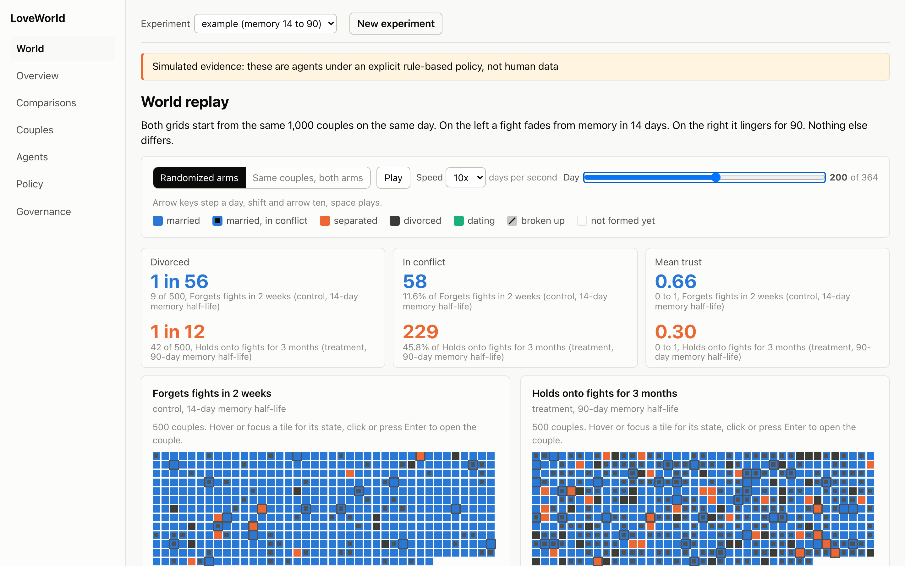
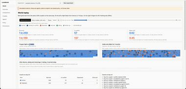

<p align="center">
  
</p>

<div align="center">

<b><font size="6">LoveWorld</font></b>

<br/>

<a href="https://github.com/jameswniu/loveworld/actions/workflows/ci.yml"></a>


<br/><br/>

A reproducible causal simulation of 1,000 married AI-agent couples over one year. Change one thing about how the agents remember, and measure what it does to divorce, trust, conflict and repair.<br/>
Everything here is simulated. The agents run an explicit rule-based policy whose every weight is printed by one command. Findings describe this world and nothing about human couples. That line is kept on purpose, because the point of the project is a clean experiment, not a prediction.

<br/>

<code>experiment.yaml -> engine -> parquet + hashes -> effects -> dashboard</code>

</div>

---

## The experiment

Each agent keeps an episodic memory of what happened with its partner. A memory of a conflict
fades with a half-life. The control arm forgets a conflict with a 14-day half-life; the treatment
arm keeps it six times longer, 90 days. Nothing else differs. Couples are randomised into arms,
every intervention and state transition is logged, and the effect is the difference between arms
with a bootstrap confidence interval and a permutation p-value.

Example run (`experiments/example.yaml`, 1,000 couples, 365 days, seeds 11/22/33):

| Outcome | Control | Treatment | Effect | 95% CI |
|---|---|---|---|---|
| Divorced within the year | 2.6% | 15.4% | +12.8 points | 9.6 to 16.4 |
| Ever separated | 19.2% | 83.0% | +63.8 points | 59.2 to 68.4 |
| Trust at the end (0 to 1) | 0.65 | 0.21 | -0.44 | -0.46 to -0.41 |
| Conflicts per couple-year | 7.4 | 12.9 | +5.5 | 4.8 to 6.2 |
| Conflicts reconciled (conditional) | 86% | 53% | -34 points | -37 to -30 |
| Days to reconcile (conditional) | 5.7 | 10.9 | +5.3 | 4.5 to 6.0 |

<p align="center">
  
</p>

Two checks ship with every experiment. The placebo run gives both arms the same parameters, and its
divorce effect is -1.2 points with a confidence interval of -3.0 to +0.4, with behavioural tables
that are byte-identical whichever arm label is applied. The twin run puts every couple through both
arms on the same random streams, and the paired divorce effect is +14.4 points (12.0 to 16.7 by
bootstrap over couples), with 16.0% of couples ending the year differently because of the intervention.

The effect is large because retained grudges feed a loop in this world. More retained negative
memory means more frequent conflicts, less repair, lower trust, and so on. That loop is a property
of the rules, all of which are inspectable and editable, and the sensitivity to the half-life is
one line away (`experiments/retention-45d.yaml` cuts the divorce effect from 12.8 to 5.2 points).

## Pick your own stressor

Memory is one knob. The same harness takes any scheduled shock aimed at one arm, and the dashboard
has a picker for them. The picker covers job loss (a stress jump to one partner that fades over
months), financial crisis (daily stress on both partners for a stretch of the year), office
temptation (more and better outside options for one partner for a while), intimacy mismatch (one
partner wants much more closeness than the other), a trait shift (one partner becomes, say, 0.3
more neurotic), daily texts (one partner sends affection every day), an anniversary and weekly
date nights. Pick the shock, the partner, the days and the size, hit Run, and a fresh experiment
with its placebo-grade statistics appears in the experiment dropdown about ten seconds later.
Example files for four of them sit in `experiments/`. A shock aimed at everyone is a world event,
so you can ask whether holding onto fights hurts more during a financial crisis.

These shocks are stylised on purpose. A job loss is a number of stress, not a bank balance, and
temptation is a probability, not a person. Each one is explicit, logged and switchable, so the
question "what does this do to this world" has one honest answer.

## How it works

<p align="center">
  
</p>

The engine (`engine/`) is a headless Bevy ECS world. Agents and couples are entities, and one
schedule of systems runs each day in a fixed order. Stress comes first, then affect (a
Gottman-style influence equation between partners), the couple interaction with its conflict,
repair and leave decisions, trust, memory pruning, the remarriage market, and the daily log. Every
random draw comes from a stream keyed by (seed, domain, id), so results do not depend on how the
ECS iterates and a couple's stream is identical across arms.

The Python package (`python/`) turns an experiment file into an engine config, runs the engine,
computes outcomes and treatment effects, and serves the results. The dashboard (`frontend/`) is a
Vite and React app over that API. The contract between the three layers is `docs/contracts.md`;
the model and the causal design are described in `docs/design.md`.

## Run it

You need Rust (stable, via rustup), uv, and Node 20 or newer.

```bash
make engine            # build the simulation engine (release)
make example           # run the example experiment and analysis into results/example
make placebo           # same experiment with treatment parameters equal to control
make twins             # every couple under both arms on the same random streams
make replay            # re-run the example and verify every table hash
make figures           # redraw the README figures from results/example/summary.json
make frontend-install  # dashboard dependencies, once
make build             # engine and dashboard bundle
make test              # Rust, Python and frontend test suites
```

A full run of 1,000 couples for a year takes about a second in the engine and about ten seconds
with the analysis. `make dashboard` then serves the API and the built dashboard on
http://127.0.0.1:8765. The engine can also be driven directly:

```bash
target/release/loveworld-engine default-config > cfg.json
target/release/loveworld-engine run --config cfg.json --out results/mine
target/release/loveworld-engine replay --manifest results/mine/manifest.json
target/release/loveworld-engine policy-spec
```

## The dashboard

<p align="center">
  
</p>

<p align="center">
  <a href="https://github.com/jameswniu/loveworld/raw/main/assets/loveworld-demo.mp4"></a>
</p>
<p align="center"><sub><a href="https://github.com/jameswniu/loveworld/raw/main/assets/loveworld-demo.mp4">Watch with sound</a></sub></p>

The World page replays the year.

- Play, pause and fast-forward at 1x, 10x or 50x days per second, with every couple as a tile coloured by state and control and treatment side by side.
- Counters per arm and a ticker of the day's events.
- Click a tile for that couple's story, the state timeline, both partners' trust and affect, every conflict, and every decision with the utilities behind it.
- A second mode shows the same couples under both arms, each tile one couple twice, with a counter of how many fates differ that day.

The other pages hold the causal readout.

- The effect table and forest plot, survival and trust curves by arm, recovery and conflict distributions.
- The agent explorer, the policy inspector, and the governance page with the placebo and twin results and the covariate balance table.
- Every couple and agent page has a collapsed "Under the hood" panel that lists, day by day, what each partner remembered and how much it weighed, how trust and affect moved, which action they chose and with what probabilities, and any shock that landed.

## Governance

| Rule | How it is enforced |
|---|---|
| No hardcoded treatment effects | The arm only sets memory half-lives; the placebo run with equal parameters is byte-identical across arm labels (Rust and Python tests) |
| Interventions separate from decisions | The policy's input type has no arm field; a test greps policy, dynamics, market and memory sources for the token `Arm` |
| Every intervention and transition logged | `interventions.parquet` has one row per agent and parameter with control and applied values; `events.parquet` carries every state change with from and to states; illegal transitions fail a test |
| Reproducible | Keyed random streams, sorted outputs, SHA-256 per table, `replay` fails on any mismatch; a tampering test proves it |
| Assignment is random and independent | Exact half split, driven only by the assignment seed; changing the population seed leaves the arm vector unchanged; balance table in every summary |
| Simulated findings stay simulated | `evidence_class: simulation` in every manifest and summary, the disclaimer on every table, and no claim in this repository about human couples |
| No LLM agents before the baseline passes | The baseline policy is rule based; LLM and learned policies are a later phase under the same harness |

Outcomes that are only defined after treatment has acted (per conflict, or among the divorced) are
marked conditional. Their permutation p-values test the sharp null of no effect on anything, which
is why a conditional outcome can show a wide interval and a small p-value at the same time. With
ten outcomes, a placebo run can be expected to show a nominally significant difference about one
time in two by chance alone, and the example placebo does on one (the reconciliation share), so
read the placebo as a whole, not outcome by outcome.

## What was borrowed

The remarriage market follows Hills and Todd's MADAM model (JASSS 2008), where singles accept a
partner when compatibility clears a threshold that relaxes with time and is anchored to the match
quality of the marriage that just ended. The daily affect update follows the influence equations in
Gottman and Murray's mathematics of marriage. The memory stream, recency decay with importance
weighting, follows Park and colleagues' Generative Agents (2023). The explicit action menu at
conflict turning points and the auditable relationship state follow RELATE-Sim (Yue and
colleagues, 2025), and the separation of an agent's private state from what its partner can see
follows Love First, Know Later (Shang and colleagues, 2025). An optional network term follows the
Wedding Ring model (Billari and colleagues, 2007).

Where this sits is written up in [docs/prior-art.md](docs/prior-art.md), a review of eighteen marriage,
divorce and kinship simulations from 2005 to 2026 in which every finding was checked against its source
by two independent readers. In that record no model gives couples a conflict process with separation and
reunion, none gives agents a memory that decays, and none randomises an intervention inside one
population; the nearest, Grow, Schnor and Van Bavel (2017), MADAM and SOCSIM, run marriage, divorce and
remarriage in one population and dissolve marriages by trade-up or hazard rate. The claim is the first
combination in this domain, not the invention of the tools, since common random numbers, placebo runs
and seeded replay are standard simulation methodology. Those earlier models are also fitted to census,
survey or register data, and this one is not. The 14 and 90 day half-lives are design parameters; no
human study in the reviewed record measures how long people hold on to a conflict.

## Roadmap

Phase 2 renders logged episodes as dialogue with a cloned voice per agent and avatar video for
selected scenes; it narrates decisions the engine already made, so it cannot touch the estimate.
Phase 3 swaps in learned policies under the same harness, an LLM policy choosing from the same five
actions and a PyTorch policy whose hidden state can be intervened on directly. Later come multi-year
and multi-generation runs, household economics, calibration against demographic rate schedules,
and legal dissolution.

## Repository layout

```
engine/        Rust crate: config, population, memory, policy, dynamics, systems, market, shocks, output, CLI
python/        uv package `loveworld`: experiments, analysis, API, CLI, tests
frontend/      Vite + React + TypeScript dashboard
experiments/   example.yaml, retention-45d.yaml, contagion-block.yaml, job-loss.yaml, daily-texts.yaml,
               neuroticism-shift.yaml, crisis-under-retention.yaml, smoke.yaml
results/       run outputs; results/example keeps the small tables and summary of the example run
docs/          design.md (model and causal design), contracts.md (schemas, CLI, API), prior-art.md (what came before),
               figures/ (the README figures, drawn by tools/figures.py and checked in CI)
tools/         figures.py, the figure generator with its fit guard
assets/        dashboard screenshots and the demo recording
```

## License

Apache License 2.0. See [LICENSE](LICENSE) and [NOTICE](NOTICE).
