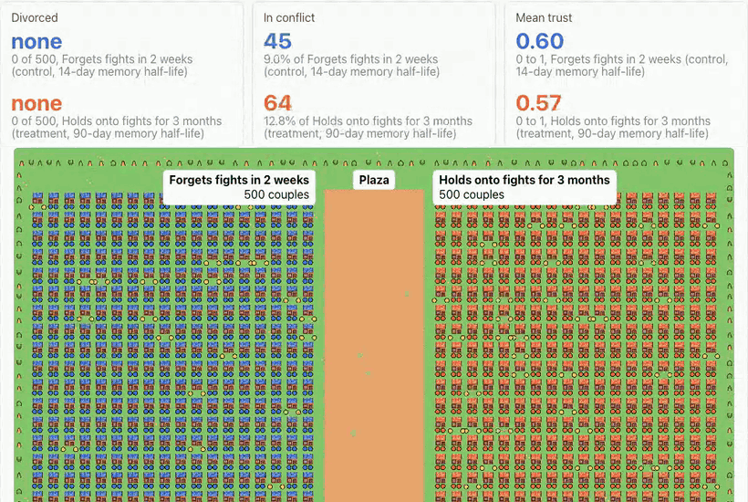
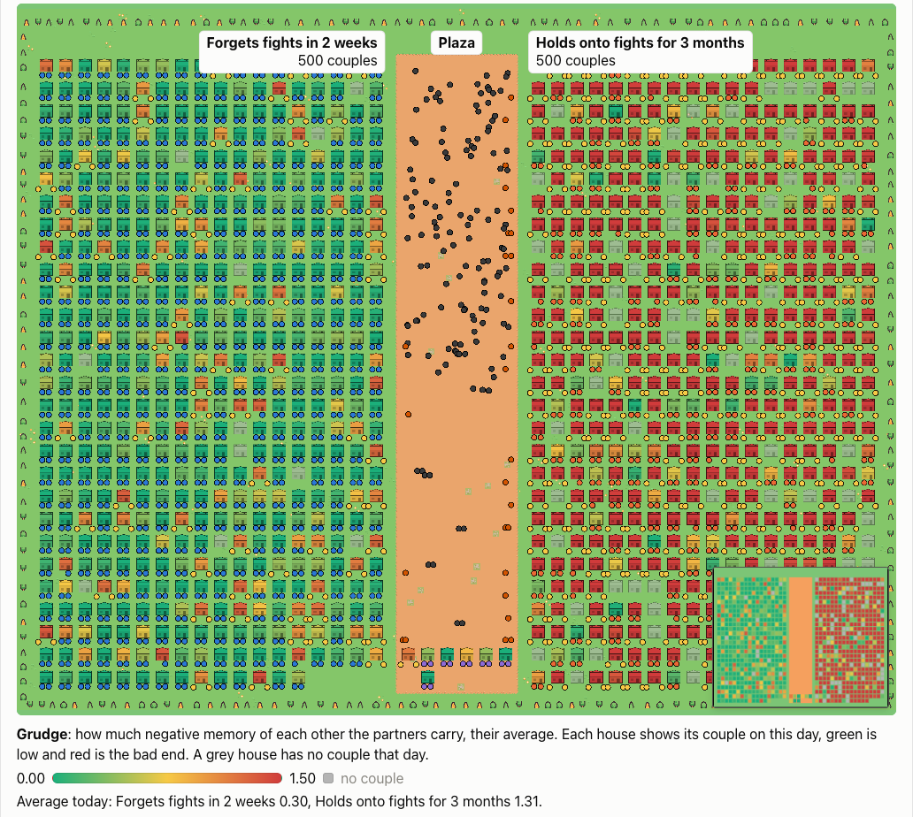
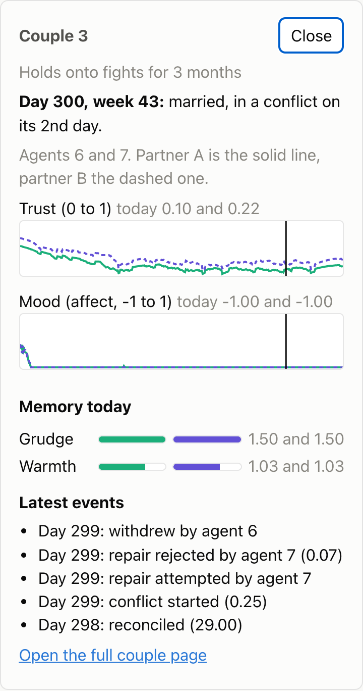

<p align="center">
  
</p>

<div align="center">

<b><font size="6">LoveWorld</font></b>

<br/>

<!-- badges:start, python3 tools/figures.py --write fills this block and --check fails when it drifts -->
<a href="https://github.com/jameswniu/multi-agent-causal-marriage-simulation/actions/workflows/ci.yml"></a>
<a href="results/example/summary.json"></a>
<a href="results/example/summary.json"></a>
<a href="results/example/manifest.json"></a>
<a href="experiments/example.yaml"></a>
<a href="LICENSE"></a>
<br/>
<a href="engine/Cargo.toml"></a>
<a href="python/pyproject.toml"></a>
<a href="frontend/package.json"></a>
<a href="python/loveworld/translate.py"></a>
<!-- badges:end -->

<br/>

A multi-agent simulation of married couples that runs a randomized controlled trial on one setting, how long each partner remembers a fight.<br/>
Every decision is logged and every run replays exactly, so each effect traces back to the rules that caused it.

<br/>

<a href="https://jameswniu.github.io/multi-agent-causal-marriage-simulation/"></a><br/>
<a href="https://jameswniu.github.io/multi-agent-causal-marriage-simulation/">Try the read-only demo in your browser</a>: the example town and three shocks run in advance, with nothing to install.

</div>

## Watch it

The World page plays the year back as a town, one house for each couple.

<p align="center">
  
</p>

- Couples on the left forget a fight in two weeks, and couples on the right hold onto it for three months.
- A couple in a fight stands outside its house, and a divorce sends both partners to the plaza.
- Lenses recolour every house by trust, stress, grudge or warmth, and a click opens that couple's year.

<p align="center">
  
  
</p>

## Try a shock

Describe a life event in plain words, and the town runs it again right where you watch.

<p align="center">
  
</p>

- An LLM (a large language model, here Claude Haiku) turns the sentence into a shock card you can read and edit before anything runs.
- The new world keeps the same couples and the same random draws, so every ring is the shock's doing.
- A switch draws the original town on the same day, and the new world's Overview compares each couple's whole year.

## What it found

In this world, holding onto fights for three months instead of two weeks drives divorce up sharply.

<p align="center">
  
</p>

- Remembered fights make the next fight likelier and repair rarer, trust wears down, and the loop runs all year.
- A placebo run, where both halves of the town get the same memory, finds no divorce effect.
- A twin run, where every couple lives both settings on the same random draws, finds an effect of about the same size.
- Halving the long memory shrinks the divorce effect, so the effect grows with how long fights are kept.

## How it works

One small config file defines an experiment, and three layers turn it into numbers anyone can rerun.

<p align="center">
  
</p>

- A Rust engine splits the couples into two groups at random, then moves every agent through each day on seeded random draws and logs each decision with the scores behind it.
- Python does the causal inference, measuring what the memory setting caused, with an interval from resampling couples for every effect.
- A React dashboard with a PixiJS town, served by FastAPI, replays the year and reads out every effect.

The model and the causal design are in [docs/design.md](docs/design.md), and every file format is in [docs/contracts.md](docs/contracts.md).

## Run it

You need Rust, uv (a Python project manager) and Node 20 or newer.

```bash
make placebo twins example   # build the engine, run both checks, then the example experiment
make replay                  # rerun the example and compare every table's SHA-256 fingerprint
make frontend-install build  # dashboard dependencies, then the engine and dashboard builds
make test                    # Rust, Python and frontend test suites
make figures-check           # fail if a figure or a badge no longer matches the results
```

Then `make serve` hosts the dashboard on http://127.0.0.1:8765. The shock box needs an Anthropic key in `ANTHROPIC_API_KEY`, and everything else runs offline. A public deployment with visitor limits is described in [docs/deploy.md](docs/deploy.md).

## Limits

- The agents follow hand-set rules fitted to no data, so every effect describes this world and nothing about people.
- The two memory lengths are design choices, since no human study measures how long people hold onto a fight.
- Shocks are stylised, so a job loss is a jump in stress rather than a bank balance.

## Prior art

[docs/prior-art.md](docs/prior-art.md) checks eighteen marriage and divorce simulations against their sources, and none pairs decaying agent memory with a randomized trial inside one population.

## License

Apache 2.0, see [LICENSE](LICENSE) and [NOTICE](NOTICE). The town art is Kenney's public-domain tile sets, credited in [CREDITS.md](frontend/public/assets/kenney/CREDITS.md).
